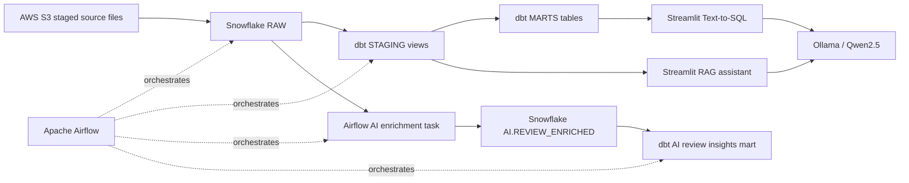

# Zomato Data Engineering & AI Platform

End-to-end food delivery analytics using AWS S3, Snowflake, dbt, Apache Airflow, Docker, and local AI.


> Repository publication is being prepared. Raw datasets and credentials are intentionally excluded.

## Overview

This project turns food-delivery operational data into tested analytical models and local AI experiences. Staged files are loaded into Snowflake RAW, dbt builds STAGING and MARTS layers, Airflow coordinates the daily sequence, and a local RoBERTa model enriches customer reviews before an AI mart is built.

It also includes two Streamlit applications: a semantic review assistant using Sentence Transformers and Ollama, and a natural-language-to-SQL interface that validates generated Snowflake SQL before user-approved execution.

## Features and status

- **Cloud ingestion:** Snowflake `COPY INTO` commands read entity files from an S3-backed stage. Implemented in the Airflow DAG.
- **Analytics engineering:** dbt staging views, dimensions, facts, marts, and data-quality tests. The latest logged run reported `PASS=40 WARN=0 ERROR=0`.
- **Workflow orchestration:** Airflow DAG `zomato_batch` runs raw loading, core dbt, review enrichment, and AI dbt in sequence. The latest inspected task logs completed successfully.
- **Review enrichment:** Local CardiffNLP RoBERTa sentiment classification plus rule-based topics and one key issue per review. Verified in Docker logs with 100 saved reviews.
- **RAG assistant:** Implemented locally with sampled reviews, normalized MiniLM embeddings, top-five retrieval, and Ollama Qwen2.5. Experimental quality and coverage.
- **Text-to-SQL:** Implemented locally with Ollama, JSON output, SQLGlot parsing, table allowlisting, result limiting, and user approval. Its configured schema still requires reconciliation with the dbt marts.

## Architecture



## Data pipeline

1. Authorized source files are placed in the configured S3-backed Snowflake stage.
2. `reload_raw` runs seven `COPY INTO` statements for restaurants, users, food, menu, orders, order items, and reviews.
3. `dbt_build_core` builds staging views, dimensions, facts, analytical marts, and tests.
4. `enrich_reviews` reads previously unenriched comments from `ZOMATO.RAW.REVIEWS`, classifies them locally, and inserts results into `ZOMATO.AI.REVIEW_ENRICHED`.
5. `dbt_build_ai` builds `mart_review_insights` from the enrichment table and staged reviews.
6. Streamlit applications query Snowflake and use local Ollama inference where required.

## Repository structure

```text
.
├── ai/
│   ├── enrich_reviews.py
│   ├── rag_chat.py
│   ├── text_to_sql.py
│   ├── test_sentiment.py
│   └── .env.example
├── airflow/
│   ├── dags/zomato_batch.py
│   ├── Dockerfile
│   ├── docker-compose.yaml
│   └── .env.example
├── Data/README.md
├── docs/
├── zomato/
│   ├── models/staging/
│   ├── models/marts/
│   ├── dbt_project.yml
│   ├── profiles.yml
│   └── run_dbt.py
├── .editorconfig
├── .gitattributes
├── .gitignore
└── requirements-ai.txt
```

## Technology stack

| Technology | Role |
| --- | --- |
| AWS S3 | External landing/staging location referenced by Snowflake stage paths |
| Snowflake | RAW, STAGING, MARTS, and AI schemas; analytical execution engine |
| dbt | SQL transformations, materializations, lineage, and data tests |
| Apache Airflow 3.0.3 | Daily workflow orchestration in Docker |
| Docker Compose | Local Airflow and PostgreSQL runtime |
| Transformers / PyTorch | CPU-based RoBERTa sentiment inference |
| Sentence Transformers | Review embeddings for semantic retrieval |
| Ollama / Qwen2.5 | Local language-model inference |
| Streamlit | RAG and Text-to-SQL user interfaces |
| SQLGlot | Parsing and structural validation of generated SQL |

## dbt models

Staging models normalize the seven RAW entities. The marts include customer, restaurant, food, and date dimensions; order and order-item facts; daily city revenue; restaurant performance; delivery SLA; and AI review insights.

The current model names and columns are documented in [the dbt model guide](docs/dbt-models.md). The `mart_daily_city_revenune` spelling is preserved because it is the existing model name.

## AI components

`enrich_reviews.py` uses `cardiffnlp/twitter-roberta-base-sentiment-latest` on CPU. Sentiment score is positive probability minus negative probability. Topics and one key issue are assigned with phrase-aware keyword rules.

`rag_chat.py` samples up to 500 staged reviews, creates normalized `all-MiniLM-L6-v2` embeddings, retrieves five nearest reviews, and sends only those reviews to Ollama `qwen2.5:3b`.

`text_to_sql.py` sends a schema-constrained prompt to Ollama `qwen2.5:1.5b`, parses the JSON response, validates the SQL with SQLGlot, limits results to 100 rows, and requires a Streamlit button click before execution.

## Getting started

### Prerequisites

- Docker Desktop with Compose.
- Access to a Snowflake account containing the documented `ZOMATO` database, schemas, stage, and source tables.
- Python for local Streamlit applications.
- Ollama with the required Qwen2.5 models.

Install local AI dependencies:

```powershell
python -m venv .venv
.\.venv\Scripts\Activate.ps1
pip install -r requirements-ai.txt
```

Copy `airflow/.env.example` to `airflow/.env` for Docker and `ai/.env.example` to `ai/.env` for Streamlit. Fill values locally; never commit them.

### Airflow

```powershell
cd airflow
docker compose build
docker compose up -d
```

Open `http://localhost:8080` and use the local credentials configured for your environment. Do not expose development credentials publicly.

The DAG is `zomato_batch`. It uses the Snowflake connection `snowflake_default` and runs core dbt before enrichment and AI dbt.

### dbt

The dbt profile reads `SNOWFLAKE_ACCOUNT`, `SNOWFLAKE_USER`, and `SNOWFLAKE_PASSWORD` from the environment and targets database `ZOMATO`, warehouse `ZOMATO_WH`, and role `DBT_ROLE`. In Airflow, dbt runs from the isolated `/opt/airflow/dbt_venv` environment.

### Ollama and Streamlit

```powershell
ollama serve
ollama pull qwen2.5:3b
ollama pull qwen2.5:1.5b
streamlit run ai/rag_chat.py
streamlit run ai/text_to_sql.py
```

The RAG app is evidence-limited by its sampled review set. The Text-to-SQL app must use a dedicated read-only Snowflake role before broader use.

## Example questions

- What are the most common complaints about delivery?
- What are the top 10 cities by GMV?
- Which cuisine has the most orders?
- What is the average delivery time by city?
- What is the cancellation rate by payment method?
- Which restaurants have the highest revenue?

## Security and data handling

Credentials, `.env` files, logs, dbt artifacts, model caches, and raw datasets are excluded by `.gitignore`. The raw local data is not published because it contains potentially personal information and its redistribution rights are not established. See [security.md](docs/security.md) and [Data/README.md](Data/README.md).

Use a dedicated read-only Snowflake role for Text-to-SQL. The current code defaults to `DBT_ROLE` if a read-only role is not configured; this is a known risk and should be resolved before production use.

## Documentation

See the [documentation index](docs/README.md) for architecture, pipeline, Snowflake, dbt, Airflow, AI, local development, security, troubleshooting, and roadmap guidance.

## Project status

The core Airflow/dbt/Snowflake pipeline and Docker-based sentiment enrichment have been verified through local execution logs. The RAG and Text-to-SQL applications are implemented but require broader runtime and schema validation. Complaint detection remains single-label and heuristic. Dashboarding, production hardening, and full data-quality validation remain future work.

## License

The license is intentionally pending confirmation of code ownership and the approved copyright holder. Third-party datasets, pretrained model weights, libraries, and external assets remain subject to their own licenses.
