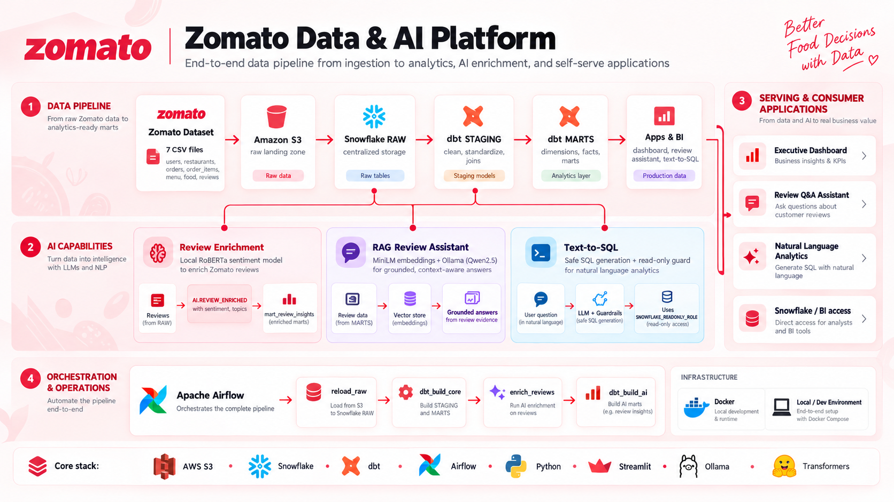
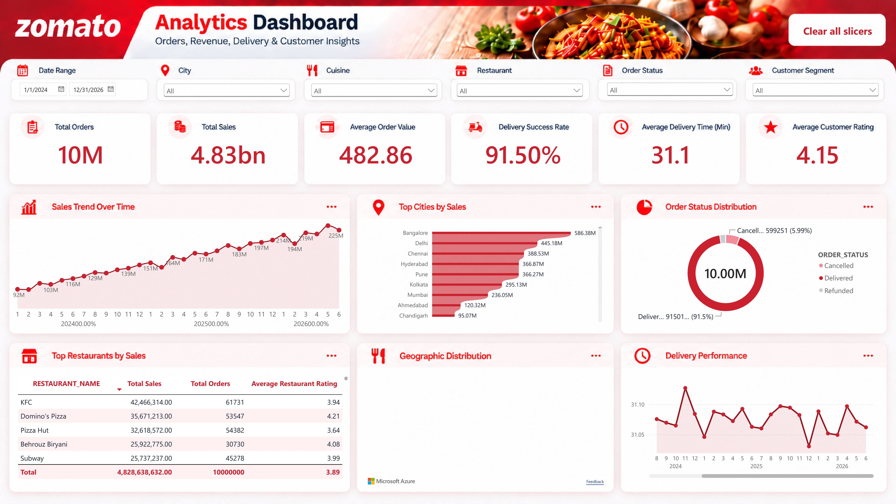

# Zomato Data Engineering & AI Platform

An end-to-end food-delivery data platform that moves operational data through cloud storage, Snowflake, dbt, Airflow, analytics applications, and local AI experiences.


## Project overview

The platform turns food-delivery source data into governed analytical models and AI-assisted experiences. Authorized source files are staged in an S3-backed Snowflake stage, loaded into Snowflake RAW, transformed by dbt into STAGING and MARTS schemas, and enriched with local review sentiment and issue analysis in the AI schema.

Apache Airflow runs the batch sequence in Docker. The repository also contains two local Streamlit AI applications: a retrieval-augmented review assistant and a guarded natural-language-to-SQL workflow. A read-only Streamlit analytics dashboard is included for current Snowflake marts, while the final Power BI dashboard is showcased below as a repository asset.

## Architecture



The verified platform flow is:

`CSV datasets -> AWS S3 -> Snowflake RAW -> dbt transformations -> Snowflake MARTS and AI -> Airflow orchestration -> Power BI and AI applications`

Snowflake is the storage and analytical execution layer. dbt owns SQL transformation logic, Airflow coordinates the batch sequence, and the AI applications run locally against Snowflake data and local Ollama models.

## Technologies

| Technology | Verified role |
| --- | --- |
| Python | Ingestion helpers, review enrichment, validation, and applications |
| AWS S3 | External landing location referenced by the Snowflake stage |
| Snowflake | RAW, STAGING, MARTS, and AI schemas; analytical execution |
| dbt | Staging models, dimensions, facts, marts, materializations, and tests |
| Apache Airflow | `zomato_batch` workflow orchestration |
| Docker Compose | Local Airflow and PostgreSQL runtime |
| Power BI | Final executive analytics dashboard artifact, supplied as a PBIX/PDF locally |
| Streamlit | Read-only analytics dashboard, RAG assistant, and Text-to-SQL UI |
| Transformers / PyTorch | CPU-based RoBERTa sentiment inference |
| Sentence Transformers | Review embeddings for semantic retrieval |
| Ollama / Qwen2.5 | Local LLM inference for RAG and Text-to-SQL |
| SQLGlot | Parsing and structural validation of generated Snowflake SQL |

## Data engineering pipeline

1. **Data ingestion:** authorized source files are made available through the configured S3-backed Snowflake stage. The Airflow `reload_raw` task executes seven `COPY INTO` statements for restaurants, users, food, menu, orders, order items, and reviews.
2. **RAW layer:** Snowflake RAW tables retain source-aligned entities for downstream processing.
3. **dbt staging:** staging views normalize the RAW entities and provide documented source/model contracts.
4. **Analytical marts:** dbt builds customer, restaurant, food, and date dimensions; order and order-item facts; daily city revenue; restaurant performance; delivery SLA; and review-insight marts.
5. **AI enrichment:** the Airflow enrichment task reads previously unenriched reviews, runs local sentiment and rule-based topic/issue analysis, and writes results to `ZOMATO.AI.REVIEW_ENRICHED`.
6. **Workflow orchestration:** Airflow runs RAW loading, core dbt, review enrichment, and AI dbt in sequence.
7. **Testing and validation:** the repository includes dependency-light unit/contract tests, Python compilation checks, YAML validation in CI, and dbt model tests for the configured Snowflake environment.

See [the data pipeline guide](docs/data-pipeline.md), [dbt model guide](docs/dbt-models.md), and [Airflow guide](docs/airflow-orchestration.md) for implementation details.

## AI capabilities

### Implemented

- **Sentiment and review enrichment:** `ai/enrich_reviews.py` uses `cardiffnlp/twitter-roberta-base-sentiment-latest` through Transformers on CPU. Phrase-aware rules assign a topic and one key issue for negative reviews, with negation handling and regression tests.
- **RAG review assistant:** `ai/rag_chat.py` samples up to 500 staged reviews, creates normalized `all-MiniLM-L6-v2` embeddings, retrieves the five highest-scoring reviews above a configurable similarity threshold, and sends only that evidence to Ollama `qwen2.5:3b`.
- **Text-to-SQL:** `ai/text_to_sql.py` asks Ollama `qwen2.5:1.5b` for a constrained JSON response, parses Snowflake SQL with SQLGlot, applies table/statement safety checks and a 100-row limit, and requires explicit user approval before execution.
- **Analytics dashboard:** `dashboard/app.py` provides fixed, read-only queries for executive metrics, revenue, delivery, customers, and AI review insights over the current MARTS schema.

### Boundaries and experimental areas

The RAG assistant is evidence-limited because it retrieves from a review sample rather than the full dataset and is not intended to answer exact aggregate questions. Text-to-SQL is implemented but requires a dedicated read-only Snowflake role and schema/allowlist reconciliation before production use. Multi-issue detection is available as an optional helper and does not change the persisted single-issue schema.

## Power BI analytics dashboard

### Zomato Analytics Command Center

The final Power BI page is preserved from the supplied dashboard PDF and shown without redesign:



The command center presents six executive KPIs:

- Total Orders
- Total Sales
- Average Order Value
- Delivery Success Rate
- Average Delivery Time
- Average Customer Rating

Its main visual areas are Sales Trend Over Time, Top Cities by Sales, Order Status Distribution, Top Restaurants by Sales, Geographic Distribution, and Delivery Performance. Interactive slicers are provided for date, city, cuisine, restaurant, order status, and customer segment.

The original PBIX is intentionally not committed to normal Git storage because it is approximately 1.35 GB and may contain embedded data. The high-resolution dashboard image is included for project documentation; use Git LFS or another controlled artifact store if the PBIX must be distributed.

## Repository structure

```text
.
├── ai/
│   ├── complaint_rules.py
│   ├── enrich_reviews.py
│   ├── rag_chat.py
│   ├── text_to_sql.py
│   └── .env.example
├── airflow/
│   ├── dags/zomato_batch.py
│   ├── Dockerfile
│   ├── docker-compose.yaml
│   └── .env.example
├── dashboard/
│   ├── app.py
│   └── query_contract.py
├── Data/README.md
├── docs/
│   ├── images/zomato-architecture.png
│   ├── images/zomato-dashboard.png
│   └── implementation guides
├── tests/
│   ├── test_complaint_rules.py
│   ├── test_dashboard_contract.py
│   ├── test_query_execution.py
│   ├── test_rag_core.py
│   └── test_text_to_sql_validation.py
├── zomato/
│   ├── models/staging/
│   ├── models/marts/
│   ├── dbt_project.yml
│   ├── profiles.yml
│   └── run_dbt.py
├── .github/workflows/validate.yml
├── requirements-ai.txt
└── requirements-test.txt
```

Raw datasets, local credentials, environment files, logs, model caches, and generated dbt state are excluded from the public repository.

## Setup and running

### Prerequisites

- Docker Desktop with Compose.
- An authorized Snowflake account containing the documented `ZOMATO` database, schemas, stage, and source tables.
- Python 3.x for local applications and tests.
- Ollama with the required local Qwen2.5 models.

### Local AI and dashboard applications

```powershell
python -m venv .venv
.\.venv\Scripts\Activate.ps1
pip install -r requirements-ai.txt

Copy-Item ai/.env.example ai/.env
ollama serve
ollama pull qwen2.5:3b
ollama pull qwen2.5:1.5b

streamlit run dashboard/app.py
streamlit run ai/rag_chat.py
streamlit run ai/text_to_sql.py
```

Fill local environment files with placeholders replaced by your own credentials. Never commit `.env`, `creds`, AWS credentials, Snowflake passwords, API keys, or connection tokens. The dashboard and Text-to-SQL application require an explicit `SNOWFLAKE_READONLY_ROLE`.

### Airflow and dbt

```powershell
Copy-Item airflow/.env.example airflow/.env
cd airflow
docker compose build
docker compose up -d
```

The Airflow DAG is `zomato_batch` and uses the `snowflake_default` connection. It builds dbt from the isolated `/opt/airflow/dbt_venv` environment. The dbt profile reads `SNOWFLAKE_ACCOUNT`, `SNOWFLAKE_USER`, and `SNOWFLAKE_PASSWORD` from the environment and targets database `ZOMATO`, warehouse `ZOMATO_WH`, and role `DBT_ROLE`.

The repository does not include Snowflake DDL, storage integrations, or raw-data acquisition credentials. Those must be provisioned separately by an authorized administrator.

## Testing

Run the repository's dependency-light checks with:

```powershell
python -m compileall -q ai dashboard
python -m unittest discover -s tests -p "test_*.py" -v
```

Continuous integration additionally installs the test dependencies and validates YAML files. Tests that require live Snowflake, Airflow, Transformers, Streamlit, or Ollama are intentionally not represented as offline integration tests; see [baseline validation](docs/baseline-validation.md) for those environment limits.

## Project highlights

- A layered RAW -> STAGING -> MARTS/AI warehouse design with dbt-owned transformations.
- A Dockerized Airflow batch workflow covering ingestion, core transformations, review enrichment, and AI marts.
- CPU-compatible local sentiment enrichment with tested complaint/topic rules.
- Evidence-constrained RAG and guarded Text-to-SQL workflows with explicit safety boundaries.
- Read-only analytics applications and a final Power BI command-center showcase.
- Public-repository hygiene for credentials, private datasets, logs, caches, and oversized dashboard binaries.

## Documentation and license

Use the [documentation index](docs/README.md) for architecture, pipeline, Snowflake, dbt, Airflow, AI, local development, security, troubleshooting, and roadmap guidance.

Original source code is licensed under the [MIT License](LICENSE), Copyright (c) 2026 Belal Hazem. Third-party datasets, pretrained model weights, libraries, and external assets remain subject to their own licenses and attribution requirements.
