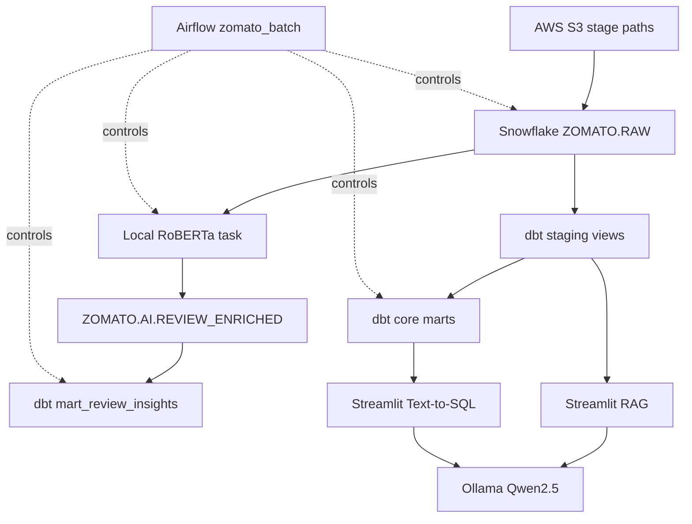

# Architecture

Airflow is the control plane. Snowflake is the persistence and analytical execution layer. dbt owns SQL transformation logic. AI applications run locally and query Snowflake at runtime.

Schemas are `RAW` for source-aligned entities, `STAGING` for cleaned views, `MARTS` for analytical models, and `AI` for persisted review enrichment. The repository does not contain Snowflake DDL for stages, file formats, or schemas.
